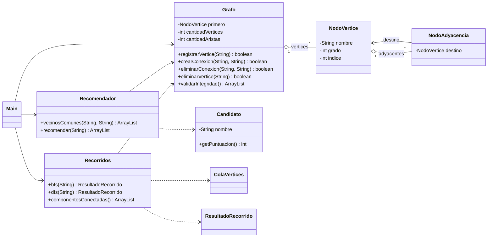
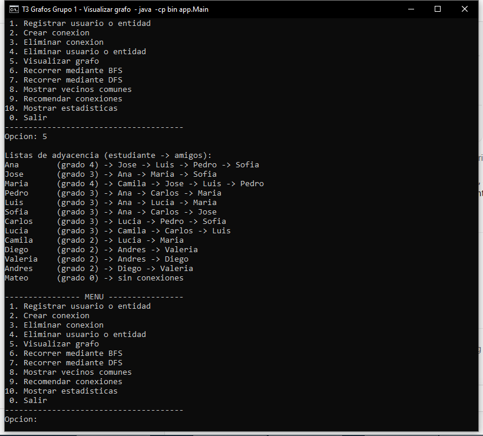
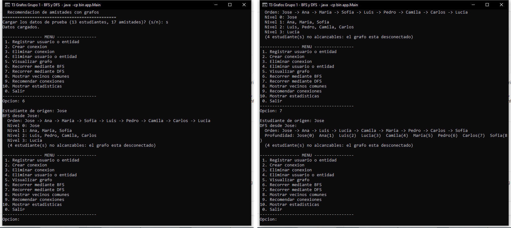
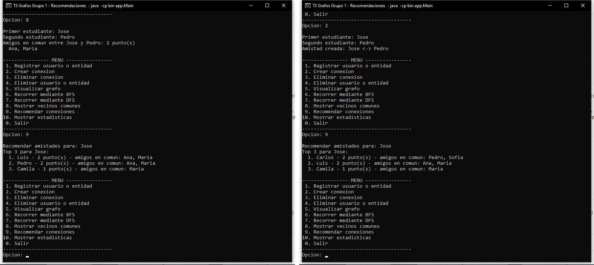

# T3 · Laboratorio de grafos y predicción de conexiones — Grupo 1

**Universidad Técnica de Ambato · FISEI · Ingeniería de Software · Estructura de Datos (Nivel III)**

**Caso del Grupo 1: Red social universitaria UTA.** Los estudiantes son los vértices y las amistades son las aristas de un grafo no dirigido.

## Índice

1. [Objetivo](#objetivo)
2. [Integrantes](#integrantes)
3. [Compilación y ejecución](#compilación-y-ejecución)
4. [Estructura del repositorio](#estructura-del-repositorio)
5. [Diagrama de clases](#diagrama-de-clases)
6. [Estructura del grafo](#estructura-del-grafo)
7. [BFS y DFS](#bfs-y-dfs)
8. [Algoritmo de recomendación](#algoritmo-de-recomendación)
9. [Resultados y evidencias](#resultados-y-evidencias)
10. [Decisiones no definidas en el enunciado](#decisiones-no-definidas-en-el-enunciado)
11. [Aportes individuales](#aportes-individuales)

Documentos: [Informe técnico](docs/InformeTecnico.md) · [Casos de prueba](pruebas/CasosPrueba.md) · [Diagrama de clases](docs/DiagramaClases.md) · [Evidencias](evidencias/)

## Objetivo

Diseñar, implementar y evaluar en Java un sistema que recomiende amistades usando un grafo con **listas de adyacencia construidas con nodos propios**, recorridos **BFS** y **DFS**, y un algoritmo de **amigos en común**.

**Reto especial del Grupo 1:** recomendar los **tres candidatos con más amigos en común** e indicar **cuáles son** esos amigos.

## Integrantes

| Integrante | Usuario de GitHub | Rol | Rama principal |
|---|---|---|---|
| Altamirano Segovia Jullisa Brigitte | [jullisaaltamirano2017-boop](https://github.com/jullisaaltamirano2017-boop) | Pruebas y evidencias | `feature/pruebas-docs` |
| Chico Yunda Juan Carlos (líder) | [juanchicoyunda1234](https://github.com/juanchicoyunda1234) | Liderazgo, recomendación, informe técnico e integración | `feature/recomendador` |
| Llamuca Abrajan Andrés Joel | [llamucaandres161](https://github.com/llamucaandres161) | Backend: CRUD e integridad | `feature/crud` |
| Romo Núñez Joseph Alejandro | [wayusa25-cmyk](https://github.com/wayusa25-cmyk) | Backend: estructura del grafo | `feature/grafo` |
| Torosina Armendariz Jeremy Alejandro | [WinoSpop](https://github.com/WinoSpop) | Recorridos BFS/DFS y diagrama de clases | `feature/recorridos` |
| Tuza Quinatoa Edith Noemi | [edithtuza15-collab](https://github.com/edithtuza15-collab) | Frontend: menú de consola | `feature/menu` |

## Compilación y ejecución

Requisitos: JDK 17 o superior (probado con JDK 21) y Visual Studio Code con el *Extension Pack for Java*. La configuración de VS Code está en [.vscode/settings.json](.vscode/settings.json).

Desde la raíz del repositorio:

```bash
javac -encoding UTF-8 -d bin src/modelo/*.java src/estructuras/*.java src/algoritmos/*.java src/app/*.java src/pruebas/*.java
```

```bash
java -cp bin app.Main
```

```bash
java -cp bin pruebas.PruebasGrafo
```

En VS Code también se puede abrir [Main.java](src/app/Main.java) y pulsar **Run**. Al iniciar, el programa pregunta si se cargan los datos de prueba: 13 estudiantes y 17 amistades.

## Estructura del repositorio

| Archivo | Contenido |
|---|---|
| [src/modelo/NodoVertice.java](src/modelo/NodoVertice.java) | Vértice: nombre, grado, índice y cabeza de su lista de adyacencia |
| [src/modelo/NodoAdyacencia.java](src/modelo/NodoAdyacencia.java) | Nodo de la lista de adyacencia (una arista) |
| [src/estructuras/Grafo.java](src/estructuras/Grafo.java) | Grafo no dirigido: CRUD, integridad y estadísticas |
| [src/estructuras/ColaVertices.java](src/estructuras/ColaVertices.java) | Cola FIFO propia para el BFS (clase auxiliar) |
| [src/algoritmos/Recorridos.java](src/algoritmos/Recorridos.java) | BFS, DFS y componentes conectadas |
| [src/algoritmos/ResultadoRecorrido.java](src/algoritmos/ResultadoRecorrido.java) | Orden de visita y niveles (clase auxiliar) |
| [src/algoritmos/Recomendador.java](src/algoritmos/Recomendador.java) | Vecinos comunes y top 3 de recomendaciones |
| [src/algoritmos/Candidato.java](src/algoritmos/Candidato.java) | Candidato con su puntuación y sus amigos en común (clase auxiliar) |
| [src/app/Main.java](src/app/Main.java) | Menú de consola con validaciones |
| [src/app/DatosPrueba.java](src/app/DatosPrueba.java) | Conjunto de 13 vértices y 17 aristas |
| [src/pruebas/PruebasGrafo.java](src/pruebas/PruebasGrafo.java) | 44 pruebas reproducibles (sin JUnit) |
| [pruebas/CasosPrueba.md](pruebas/CasosPrueba.md) | Entradas, operaciones y salidas reales |
| [evidencias/](evidencias/) | `grafo.png`, `bfs-dfs.png`, `recomendaciones.png` |
| [docs/InformeTecnico.md](docs/InformeTecnico.md) | Informe técnico breve |
| [docs/DiagramaClases.md](docs/DiagramaClases.md) | Diagrama de clases en Mermaid |

## Diagrama de clases

Vista resumida. La versión completa, con atributos y métodos, está en [docs/DiagramaClases.md](docs/DiagramaClases.md).



## Estructura del grafo

- **Lista de vértices:** una lista enlazada simple de `NodoVertice`, con punteros `primero` y `ultimo` para insertar en O(1).
- **Lista de adyacencia:** cada vértice apunta a su propia lista de `NodoAdyacencia`. La amistad A–B se guarda **dos veces**, B en la lista de A y A en la lista de B, porque el grafo es no dirigido.
- **Orden alfabético:** cada lista de adyacencia se mantiene ordenada. Por eso BFS, DFS y las recomendaciones dan siempre el mismo resultado, y los amigos en común se calculan intersecando dos listas ordenadas.
- **Índice 0..n-1 por vértice:** permite marcar "visitado" o "es amigo" en un `boolean[]` sin usar `HashMap` ni `HashSet`. Al eliminar un vértice, los índices se vuelven a numerar.
- **Nombres únicos sin distinguir mayúsculas:** "ana" y "Ana" son el mismo estudiante. Los espacios repetidos se normalizan.

```
primero -> [Ana] -> [Jose] -> [Maria] -> ... -> [Mateo] <- ultimo
             |
             +-> Jose -> Luis -> Pedro -> Sofia
```

Restricción cumplida: no se usan bibliotecas de grafos, `HashMap`, `HashSet`, `TreeMap` ni `TreeSet`. `ArrayList` solo se usa para devolver resultados.

## BFS y DFS

Código: [Recorridos.java](src/algoritmos/Recorridos.java) · Cola propia: [ColaVertices.java](src/estructuras/ColaVertices.java)

- **BFS (por niveles):** primero visita el origen (nivel 0), luego todos sus amigos (nivel 1), luego los amigos de esos (nivel 2), y así. Cada vértice se marca como visitado **al encolarlo**, para que nunca entre dos veces a la cola. El nivel de un vértice es la cantidad de amistades que lo separan del origen.
- **DFS (en profundidad):** es recursivo; la pila es la pila de llamadas de Java. Baja por el primer amigo no visitado hasta donde puede y retrocede cuando ya no hay amigos nuevos.
- Ambos son **O(V + E)**: cada vértice se visita una vez y cada lista de adyacencia se recorre una vez.
- **Componentes conectadas** (opción 10): se lanza un BFS desde cada vértice todavía no visitado, y cada BFS descubre un grupo completo.

## Algoritmo de recomendación

Código: [Recomendador.java](src/algoritmos/Recomendador.java) · [Candidato.java](src/algoritmos/Candidato.java)

Para un usuario U:

1. Se marcan sus amigos directos en `esAmigo[]`.
2. Para cada amigo A de U se recorre la lista de A. Cada vértice C que **no es U** y **no es amigo de U** es un candidato, y A se agrega como amigo en común de C.
3. Un arreglo `Candidato[] porIndice` garantiza **un solo objeto por candidato**, así que no hay duplicados.
4. Los candidatos se ordenan por inserción: **mayor puntuación primero**, y en caso de empate **orden alfabético** (desempate determinista).
5. Se devuelven los **3 primeros** con su puntuación y la lista de amigos en común.

**Ejemplo del enunciado:** José es amigo de Ana y María, y Pedro también. Pedro recibe **2 puntos (Ana, María)**. Después de crear la amistad José–Pedro, Pedro ya no aparece como candidato.

## Resultados y evidencias

Con los datos de prueba, 44 de 44 pruebas pasan. El detalle está en [pruebas/CasosPrueba.md](pruebas/CasosPrueba.md).

| Consulta | Resultado |
|---|---|
| BFS desde Jose | Jose → Ana → Maria → Sofia → Luis → Pedro → Camila → Carlos → Lucia |
| DFS desde Jose | Jose → Ana → Luis → Lucia → Camila → Maria → Pedro → Carlos → Sofia |
| Top 3 para Jose | Luis 2 (Ana, Maria) · Pedro 2 (Ana, Maria) · Camila 1 (Maria) |
| Top 3 tras José–Pedro | Carlos 2 (Pedro, Sofia) · Luis 2 (Ana, Maria) · Camila 1 (Maria) |
| Componentes | 3 grupos: los 9 conectados con Jose, Diego/Valeria/Andres, y Mateo aislado |

### Grafo: listas de adyacencia (opción 5)


### BFS y DFS desde Jose (opciones 6 y 7)


### Vecinos comunes y recomendaciones, antes y después de crear José–Pedro (opciones 8, 9 y 2)


## Decisiones no definidas en el enunciado

| Tema | Decisión |
|---|---|
| Desempate | Orden alfabético del nombre |
| Mínimo para ser candidato | 1 amigo en común |
| Opción 10 "Estadísticas" | Vértices, aristas, grado promedio, más conectado, aislados, componentes conectadas e integridad (RF10) |
| Identificador | Nombre único, de 2 a 40 letras, sin distinguir mayúsculas |
| Datos de prueba | Sin tildes, para evitar problemas de codificación en la consola |

## Aportes individuales

| Integrante | Funcionalidad | Archivos | Ramas y PR | Revisó o integró |
|---|---|---|---|---|
| Romo Núñez Joseph | Estructura del grafo | `modelo/*`, `Grafo` (parte 1) | `feature/grafo`, PR #10, #11, #12 | PR #9 |
| Llamuca Abrajan Andrés | CRUD e integridad | `Grafo` (parte 2) | `feature/crud`, PR #9 | PR #10, #11, #12 |
| Torosina Armendariz Jeremy | BFS, DFS, componentes y diagrama de clases | `ColaVertices`, `Recorridos`, `ResultadoRecorrido`, `docs/DiagramaClases.md` | `features/recorridos`, PR #8 | PR #14 |
| Chico Yunda Juan Carlos | Recomendación, reto especial, informe técnico e integración final | `Recomendador`, `Candidato`, `docs/InformeTecnico.md`, README | `feature/recomendador`, PR #14 | PR #8, PR #13 |
| Tuza Quinatoa Noemi | Menú y validaciones | `Main`, `DatosPrueba` | `feature/menu`, PR pendiente | PR #13 |
| Altamirano Segovia Jullisa | Pruebas y evidencias | `PruebasGrafo`, `pruebas/`, `evidencias/` | `feature/pruebas-docs`, PR #13 | PR pendiente |

