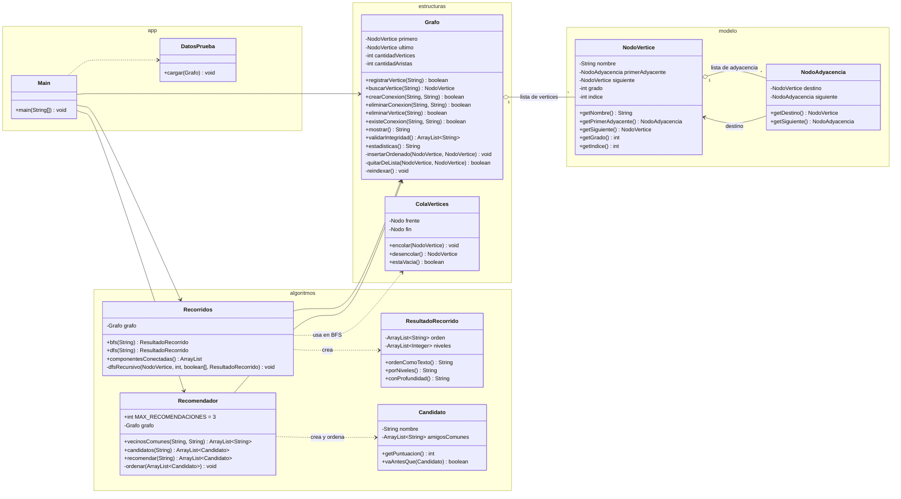

# Diagrama de clases — T3 Grafos, Grupo 1

[⬅ Volver al README](../README.md)

GitHub dibuja este diagrama automáticamente porque está escrito en Mermaid.

## Lectura del diagrama

| Relación | Significado |
|---|---|
| `Grafo` → `NodoVertice` | El grafo es una lista enlazada de vértices (`primero` → `siguiente` → …). |
| `NodoVertice` → `NodoAdyacencia` | Cada vértice es dueño de su lista de adyacencia: sus amistades. |
| `NodoAdyacencia` → `NodoVertice` | Cada arista apunta al vértice amigo (`destino`), no a una copia. |
| `Recorridos` y `Recomendador` → `Grafo` | Los algoritmos están separados de la estructura y solo la leen. |
| `Main` | Capa de aplicación: el menú usa el grafo y los dos algoritmos. |

Capas: **modelo** (datos) → **estructuras** (grafo y cola) → **algoritmos** (BFS, DFS, recomendación) → **app** (consola).
