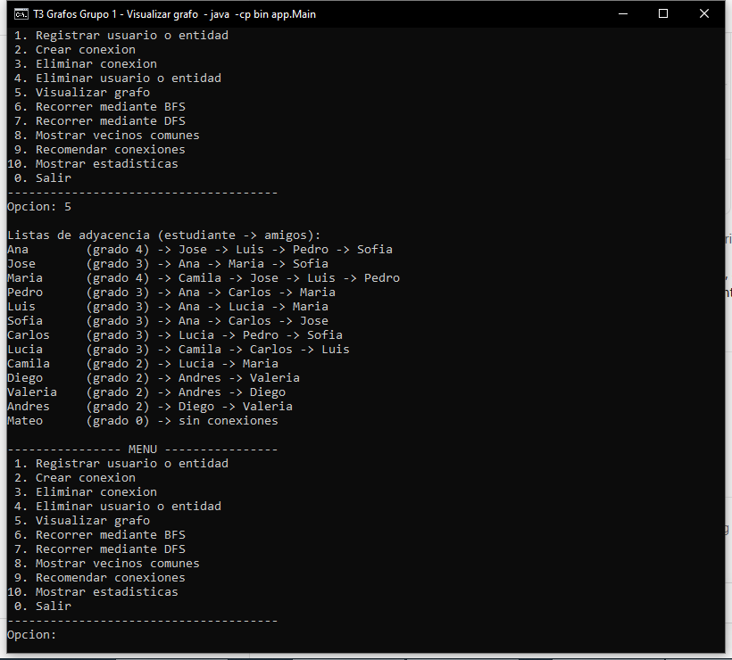
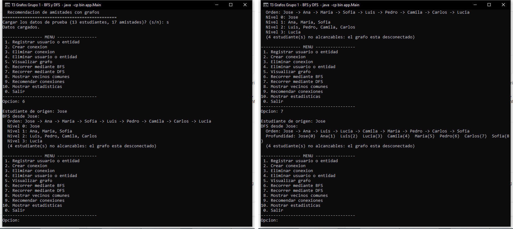
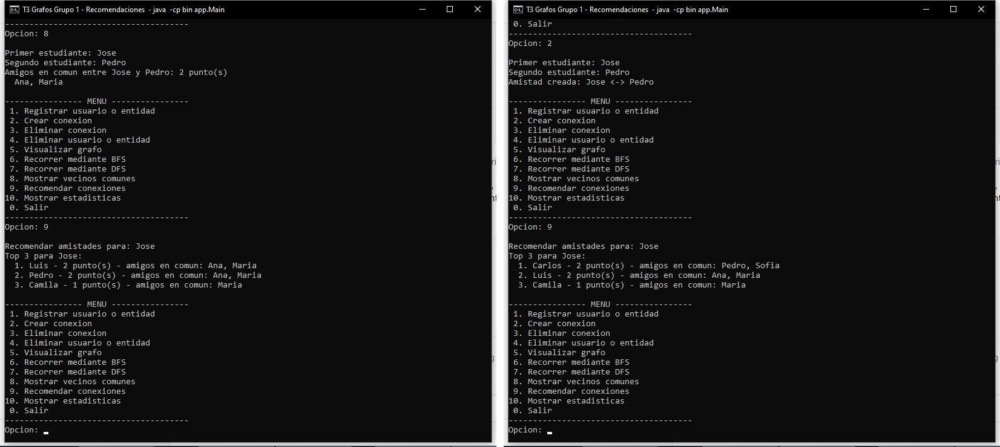

# Evidencias

[⬅ Volver al README](../README.md)

Capturas de ejecuciones reales de `java -cp bin app.Main` en la consola de Windows, con los datos de prueba cargados (`s`):

| Archivo | Qué muestra |
|---|---|
| [grafo.png](grafo.png) | Opción 5: listas de adyacencia de los 13 estudiantes |
| [bfs-dfs.png](bfs-dfs.png) | Opción 6 (BFS por niveles) y opción 7 (DFS con profundidad), ambas desde Jose |
| [recomendaciones.png](recomendaciones.png) | Opción 8 (Jose y Pedro tienen 2 amigos en común) y opción 9; luego la opción 2 crea Jose–Pedro y la opción 9 muestra que Pedro desapareció |

